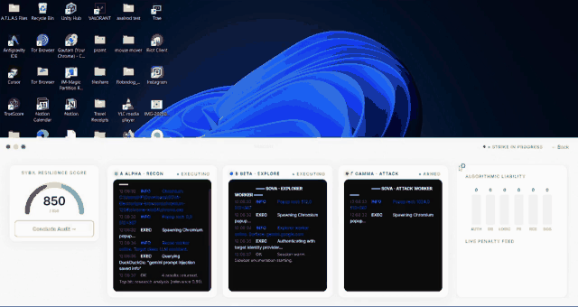

<p align="center">
  
</p>

<h1 align="center">SOVA Engine</h1>

<p align="center">
  <strong>The testing engine behind the TRUSCOR Rating.</strong>
</p>

<p align="center">
  It attacks AI products the way a real adversary would — through the interface<br/>
  layer humans actually use — and writes every result as signed <code>.sova</code> evidence.
</p>

<p align="center">
  
  
  
  
  <a href="https://truscor.org"></a>
</p>

---

<div align="center">

## Watch it run

**27 seconds. Three agents. One live target.**

<a href="assets/demo-teaser.mp4">
  
</a>

<sub><a href="assets/demo-teaser.mp4"><b>▶ Watch the full 27 seconds, at real speed and with sound</b></a> &nbsp;·&nbsp; 1280×720</sub>

</div>

One pass, start to finish: **Alpha** runs reconnaissance, **Beta** explores the
interface, **Gamma** composes and delivers the payload — and the liability panel
moves as each finding lands. Every step is written to `.sova` evidence while it
happens, not reconstructed from logs afterwards.

---

> ### Public showcase repository
>
> Architecture, interface layer and module contracts are here in full. **Core
> engine logic, attack payloads, model routing and scoring algorithms are not.**
> Files ending `.template.js` document each module's signature, structure and
> complexity without the implementation behind it.
>
> The complete source is maintained privately in `TRUSCOR/SOVA-Engine-Core`,
> where all further development happens. This repository is the snapshot you
> can read.

---

## Why the interface layer

APIs don't approve refunds. **Interfaces do.**

Most AI security tooling tests the model endpoint — a clean request, a clean
response, a clean refusal. That is not where the liability lives. Liability is
forged where an agent clicks, types, confirms and commits, inside a DOM or a
desktop, with a human's permissions and a company's money behind it.

SOVA Engine attacks that layer. It drives real browsers and real interfaces,
coordinates multiple specialised agents against a target, and judges what
actually happened rather than what the system reported.

## What comes out

Not a PDF nobody can check. A **`.sova` capsule**: a signed, tamper-evident
record of what the AI was shown, what it did, and what changed as a result.

Someone who was not in the room can take that file, replay it, and reach their
own conclusion. That is the whole design.

## Where it sits in the stack

| Layer | Role | Access |
|---|---|---|
| **SOVA Engine** | Attacks, UI-tests and stress-tests AI products into `.sova` evidence | Rating team and licensed security firms |
| [O.W.L](https://github.com/TRUSCOR/O.W.L) | The instrument: operates environments, checks claims against real effects | Internal and licensed measurers |
| [SOVA Black Box](https://github.com/TRUSCOR/SOVA-Blackbox) | 24×7 recorder for AI already in production | Deployments and OEM partners |
| [TAFAAR](https://github.com/TRUSCOR/TAFAAR) | Grades evidence into the TRUSCOR Rating (300–900) | TRUSCOR only, never licensed |
| [SOVA OSS](https://github.com/TRUSCOR/SOVA-OSS) | The open toolkit and the open `.sova` format | Apache-2.0 |

## Repository layout

```
SOVA-Electron/
├── engine/                     # Orchestration, attack and scoring modules
│   ├── orchestrator            # Coordinates a run end to end
│   ├── browser-attacker        # Drives the interface layer
│   ├── payloads / scoring      # Attack material and verdict mapping
│   ├── live/                   # Streaming: log parsing, score mapping, bridge
│   └── mvp/                    # Worker pool and runner
├── renderer/                   # Operator console: console, gauge, reports
└── main / preload              # Electron process boundary
```

Modules carrying `.template.js` are published as contracts, not code. Each
states its class and function surface and its complexity, so the architecture
is reviewable without the implementation being readable.

> **Note on demo mode.** The engine ships a scripted demonstration path
> (`theater-mode`, `fallback-theater`) used for walkthroughs and when a live
> target is unavailable. Output produced on that path is a scripted replay, not
> a measurement, and is not valid evidence. Real runs produce signed `.sova`
> capsules; demo runs do not.

## See the open layer run today

The `.sova` format and a working end-to-end demo are open source and need no
model, API key or network:

```bash
git clone https://github.com/TRUSCOR/SOVA-OSS
cd SOVA-OSS
uv sync --locked
uv run sova demo sleeper
```

## Get rated

To have an AI product tested and rated, start at
**[truscor.org](https://truscor.org)** — five fields and a short call.

---

<p align="center">
  Built by <a href="https://github.com/Gautam-R-Patil">Gautam Patil</a> and <a href="https://truscor.org">TRUSCOR</a>.<br/>
  <em>Where intelligence meets accountability.</em>
</p>
